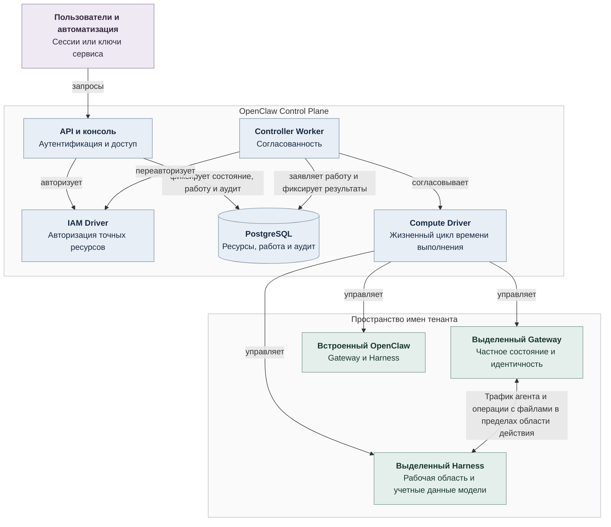

# Рекомендации по улучшению проекта ZeptoClaw

## 1. Введение
Проект ZeptoClaw представляет собой децентрализованную P2P-сеть автономных AI-агентов на базе PicoClaw. Данный документ содержит рекомендации по улучшению проекта на основе анализа OpenClaw Enterprise.

## 2. Основные рекомендации

### 2.1 Управление агентами
- **Создание и удаление агентов**: Улучшить интерфейс для управления агентами, добавив функции для мониторинга и логирования.
- **Развертывание и обновление агентов**: Разработать механизмы для автоматического развертывания и обновления агентов.
- **Мониторинг состояния агентов**: Внедрить систему мониторинга состояния агентов для обеспечения их стабильной работы.

### 2.2 Управление инфраструктурой
- **Поддержка различных драйверов**: Разработать и интегрировать дополнительные драйверы для управления инфраструктурой.
- **Автоматическое масштабирование ресурсов**: Внедрить механизмы автоматического масштабирования ресурсов для обеспечения их эффективного использования.
- **Мониторинг и логирование инфраструктуры**: Разработать систему мониторинга и логирования инфраструктуры для обеспечения ее стабильной работы.

### 2.3 Безопасность
- **Аутентификация и авторизация пользователей**: Улучшить механизмы аутентификации и авторизации пользователей для обеспечения безопасности системы.
- **Изоляция агентов и управления доступом**: Разработать механизмы изоляции агентов и управления доступом для обеспечения безопасности системы.
- **Аудит действий пользователей**: Внедрить систему аудита действий пользователей для обеспечения безопасности системы.

### 2.4 Интеграция с внешними сервисами
- **Поддержка различных моделей и провайдеров**: Разработать и интегрировать дополнительные модели и провайдеры для обеспечения гибкости системы.
- **Интеграция с внешними API и сервисами**: Разработать механизмы интеграции с внешними API и сервисами для обеспечения их взаимодействия.

## 3. Технические улучшения

### 3.1 Язык программирования
- **Go для серверной части**: Использовать Go для разработки серверной части проекта.
- **TypeScript для веб-интерфейса**: Использовать TypeScript для разработки веб-интерфейса проекта.

### 3.2 Инфраструктура
- **Kubernetes для развертывания и управления агентами**: Использовать Kubernetes для развертывания и управления агентами.
- **PostgreSQL для хранения данных**: Использовать PostgreSQL для хранения данных проекта.
- **Docker и Podman для контейнеризации**: Использовать Docker и Podman для контейнеризации проекта.

### 3.3 Инструменты разработки
- **Node.js 24 или новее**: Использовать Node.js 24 или новее для разработки проекта.
- **pnpm для управления зависимостями**: Использовать pnpm для управления зависимостями проекта.
- **Go для серверной части**: Использовать Go для серверной части проекта.

## 4. Архитектура системы

### 4.1 Компоненты системы
- **OpenClaw Control Plane (OCC)**: Управляет ресурсами, авторизацией и жизненным циклом агентов.
- **API и консоль**: Обеспечивает взаимодействие с пользователями и автоматизацией.
- **IAM Driver**: Управляет идентификацией, ролями и авторизацией.
- **PostgreSQL**: Хранит состояние платформы, политики IAM, работу контроллера и аудитные записи.
- **Controller Worker**: Обеспечивает согласованность и управление инфраструктурой.
- **Compute Driver**: Управляет жизненным циклом времени выполнения каждого агента.

### 4.2 Диаграмма системы

## 5. Заключение
Проект ZeptoClaw требует значительных улучшений для обеспечения его безопасности, масштабируемости и гибкости. Рекомендуется следовать предложенным улучшениям и интегрировать их в проект для достижения лучших результатов.

---

## 6. Журнал обслуживания репозитория

### 2026-10-16: очистка сборочных артефактов и обновление документации

- **Причина публикации на GitHub**: в историю коммитов попали сборочные
  артефакты `zeptoclaw_rust/target/` — репозиторий раздулся до ~725 МБ, push
  превышал лимиты GitHub. История очищена (`git filter-branch`), объекты
  спрессованы (`git gc --aggressive --prune=now`); размер `.git` — ~1.2 МБ.
- **`.gitignore`** дополнен правилами для Rust (`zeptoclaw_rust/target/`,
  `*.rs.bk`), Go (`bin/`, `dist/`, `*.test`), Node/UI (`node_modules/`,
  `ui/dist/`), Python (`__pycache__/`, `.venv/`), runtime-данных
  (`zeptomesh-data/`, `*.log`) и архивов (`*.zip`, `*.tar.gz`). Проверено
  через `git check-ignore`.
- **Рабочее дерево**: удалены `zeptoclaw_rust/target/` (~2.3 ГБ) и
  `zeptoclaw_rust/zeptomesh-data/` (данные dev-запусков). После очистки
  проект занимает ~2.8 МБ; `git status` чист, tracked-артефактов нет.
- **Документация**: в `zeptoclaw_rust/RUST_PORT.md` добавлен раздел
  «Очистка проекта (обслуживание)» с командами `cargo clean` / `git gc`;
  README верхнего уровня и `zeptoclaw_rust/README.md` уже содержат корректные
  ссылки на статус порта и предупреждение о непопадании `target/` в VCS.
